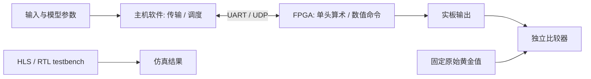

# 软件、仿真、硬件如何区分

## 按执行位置分类

| 内容 | 工程角色 | 执行位置 | 是否属于硬件推理证据 |
|---|---|---|---|
| 单头 `src_hls/conformer_head.cpp` | HLS 硬件算法 | C 仿真或综合后 FPGA | C 仿真通过本身不属于实板证据 |
| 单头 `rtl/*.sv`、`rtl/generated/*.v` | UART 桥与计算 RTL | FPGA | 需实际部署并核对输出 |
| `constraints/*.xdc`、Tcl | 引脚/时钟/综合实现配置 | Vivado | 资源与时序报告属于实现证据 |
| 单头 `host/transport.py` | 数据搬运、CRC、字节解析 | 主机 CPU | 通信通过不能替代数值验证 |
| 单头 `host/integer_reference.py`、`source_model.py` | 整数及原模型参考 | 主机 CPU | 是离线比较参考 |
| V5 `rtl/` | 命令引擎、UDP、PHY 初始化 | FPGA | 配合原案例完整实板验收 |
| V5 `host/` | ONNX 节点调度、存储及布局、通信 | 主机 CPU + FPGA | 主机代码自身不能证明 FPGA 输出正确 |
| V5 `diagnostics/compat_cpu.py`、`host_pipeline_emulation.py` | CPU 数值参考与离线命令仿真 | 主机 CPU | 不是 FPGA 实板证据 |
| V5 `sim/tb_*.sv` | RTL testbench | Icarus / XSIM | 仅仿真证据 |
| V5 `tests/`、独立比较器测试 | 协议和验收函数单元测试 | 主机 CPU | 仅软件逻辑证据 |
| `reports/`、第二例 `result.json` | 已归档的实现/物理运行记录 | 由各报告标记 | 注意成功范围与失败状态 |
| `results/layernorm_gpu_study/` | LayerNorm 软件数值实验 | GPU，`fpga_executed=false` | 不是 FPGA 证据 |

## 两个硬件项目的定位

**conformer_attention_head** 是边界较完整的 HLS 硬件示例。输入已位于 `norm_mha` 后，数据镜像包含原 FP32 参数，板上完成动态量化及该注意力头的算术。片外传输时间和 HLS 理想周期延迟需要分别报告。

**asr_qdq_fpga** 是模型级主机/FPGA 协同执行研究。主机保存节点间张量、组织分块；动态算术通过 FPGA 命令执行。Encoder 用 V5 FP32 FMA 等兼容路径，Decoder 沿用 V2 数值命令。原始 INT16 QDQ 模型中含浮点运算，不能按名称推断整个执行器只有 INT16 算术。

第二例 Decoder 的失败具有较高研究价值，应和第一例成功一起阅读。它显示通信正常与 Encoder 逐位一致仍不足以证明整个模型的数值正确性。
