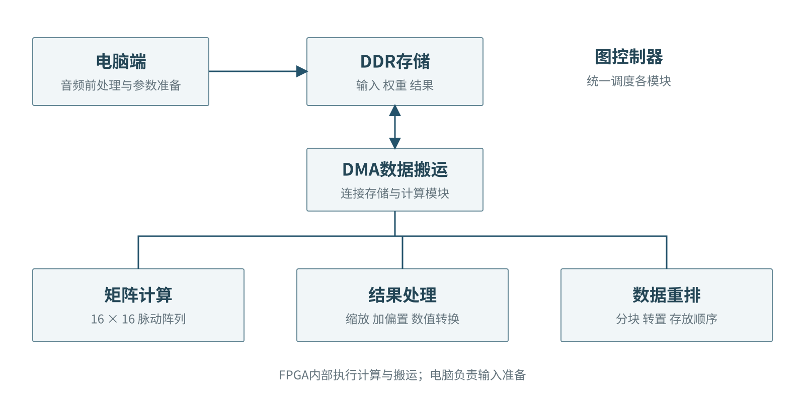
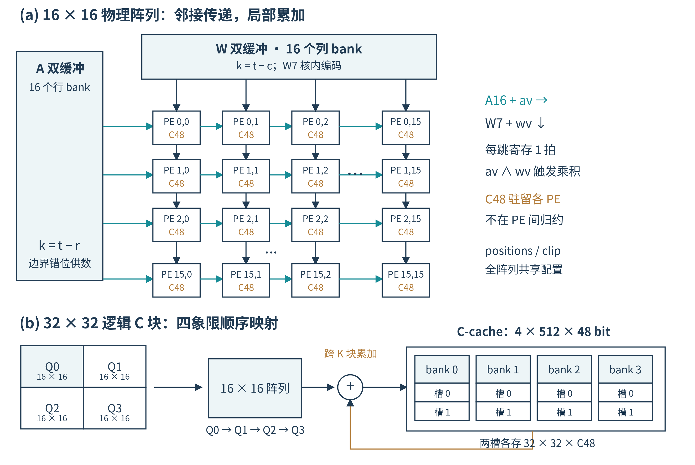
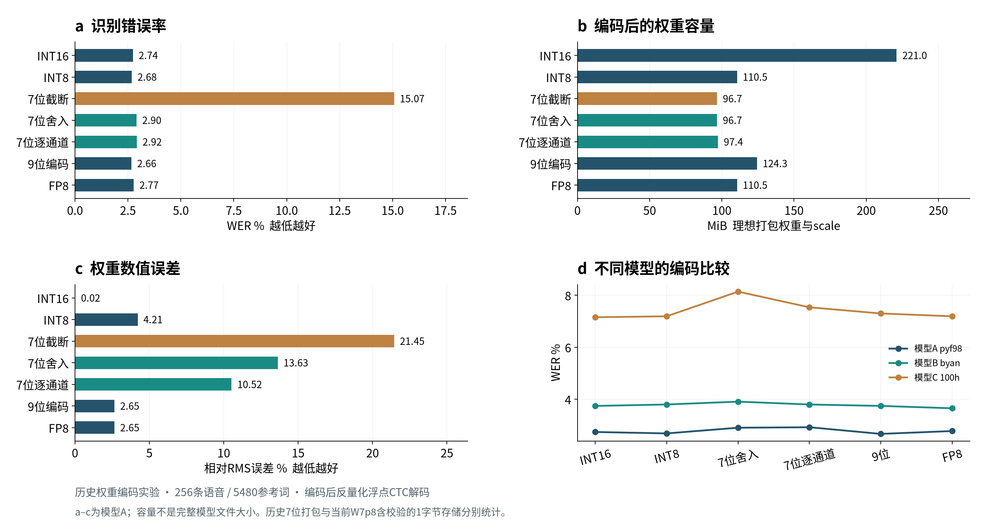
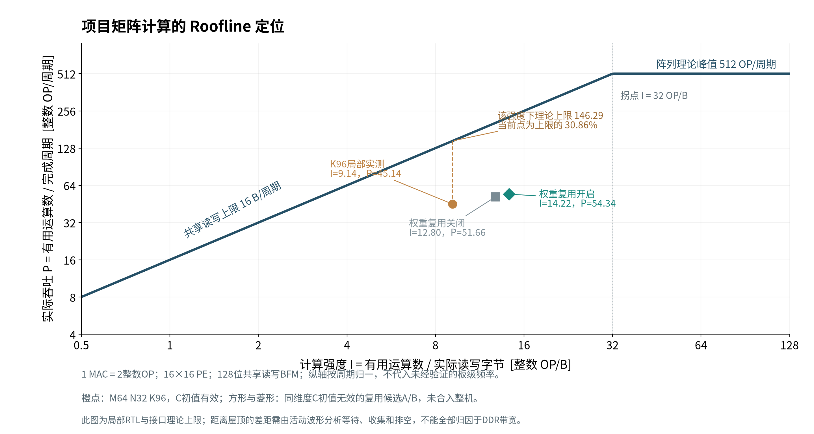

# 面向语音模型的FPGA矩阵计算架构与可观测优化设计报告

本项目固定电脑端输入准备、FPGA执行计算与搬运的整体框架，采用W7p8权重、A16激活和C48累加。当前交付包含可执行的统一小图RTL候选、局部矩阵测量、权重量化历史实验、修复后的技能包，以及标准形式的Roofline定位。以下按照选题指南3.3.5.3组织。目录对照3.3.5.4；短视频PPT不设封面，讲稿另存为Markdown。

## 1 选题背景与创新点

语音模型包含密集矩阵乘加，也需要缩放、加偏置、数值转换和数据重排。仅增加计算单元不能保证整条链路更快：输入准备、重复读取、部分和收集与输出排空都可能限制吞吐。本项目围绕固定数值合同设计矩阵核心，再用真实搬运记录和模块状态分析执行过程。

已有工作中，Eyeriss强调数据流与片上复用，Gemmini展示矩阵阵列、缓存与软件接口的分层组织；本项目借鉴其表达和分析方法，实际实现与测量以本工程源码、日志为准，不将文献性能当成本项目结果。

项目设计特点为：特殊权重编码对应的16×4位幅值乘法及移位恢复；16×16阵列映射32×32逻辑块；C48到A16的融合后处理；搬运账本与活动波形协同定位Roofline。它们是本项目的实现特点，不宣称首次提出相关算法。

## 2 设计原理与功能框图



电脑负责音频前处理、参数检查与输入打包。图控制器调度矩阵、结果处理、数据重排及其DMA通路。展示名称“结果处理”表示本图中的缩放、加偏置和数值转换等工作；源代码中的vector模块名称保持不变。数据重排表示分块、转置与存放顺序调整，DMA表示实际搬运，二者分别保留。

### 2.1 阵列组织



物理阵列为16×16，A沿行向右、W沿列向下传递，valid跟随操作数。每个PE持有局部C48累加，C不在相邻PE间做归约。32×32逻辑输出块分四象限执行，跨K块部分和由C缓存保存。A缓存4096 B、W缓存2048 B、C缓存12288 B；这些是源级数组容量，不是综合后的BRAM占用。

### 2.2 固定量化合同

W7p8每个权重占1 B：bit7为偶校验，bit6为符号S，bit5:4为索引J，bit3:0为幅值M。p=positions[J]，普通值为w=(−1)^S×M×2^p；启用clip且p=12、M≥8时幅值为32767。它与普通二补码INT7不同。

A16包括−32768。PE以无符号16位保存绝对值，计算幅值乘法、移位与clip修正，恢复符号后形成32位乘积，符号扩展到C48。累加按2^48回绕。输出链为C48转FP32最近偶数舍入、单次舍入FP32 FMA执行scale/bias、可选ReLU、最近偶数舍入与饱和到A16。

融合只在显式允许且消费者兼容时启用；其他情况保留C48输出。一个32×32块若避免一次C48写回与一次重读，可少搬12288 B中间结果。这是满足融合条件的格式推导，不是整机流量下降比例。

同元素数下，FP32权重4 B变为W7p8的1 B，激活4 B变为A16的2 B，累加结果使用C48的6 B。矩阵有用乘加次数不因位宽下降而改变。

## 3 软硬件划分依据与接口设计

电脑适合完成音频准备、文件与模型参数解析、校验和任务组织；FPGA适合重复矩阵乘加与约定数值处理。旧版base_v021.py存在电脑逐算子调度，新版统一顶层引入PL图控制器；本报告分别保留来源，不把两者描述成同一次执行。

| 接口或数据 | 合同 | 依据 |
|---|---|---|
| 控制口 | AXI4-Lite，24位地址、32位数据 | 统一顶层端口 |
| 数据口 | AXI，40位地址、128位数据 | 统一顶层与DMA |
| 时钟 | 当前为单时钟逻辑候选 | RTL顶层 |
| 权重 | 1 B存储，7位数值加偶校验，位置表与clip随配置保留 | 主机与PE解释一致 |
| 输入及输出 | A16；支持C48回退或兼容条件下融合A16输出 | 统一图与融合合同 |
| 正常完成 | b_pending=0且quiesced=1 | 测试检查 |
| 写响应故障 | 错误隔离并要求复位，不能将超时作为成功 | hold-B负向测试 |

## 4 优化过程与性能资源对比

### 4.1 权重量化比较



四宫格只采用2026-10-05同批权重编码实验，不含LoRA。256条LibriSpeech test-clean语音、5480参考词；rank≥2权重编码后反量化，激活等保持FP32，ESPnet CTC greedy解码。a至c为pyf98模型，d为三模型结果。容量是理想编码权重载荷加scale，不是完整ONNX文件或当前含校验W7p8的容量。

| 模式 | pyf98 WER | 权重与scale容量 MiB |
|---|---:|---:|
| INT16 | 2.7372% | 221.045 |
| INT8 | 2.6825% | 110.523 |
| 7位截断 | 15.0730% | 96.708 |
| 7位舍入 | 2.9015% | 96.708 |
| 7位逐通道 | 2.9197% | 97.368 |
| 9位编码 | 2.6642% | 124.338 |
| FP8 E4M3 | 2.7737% | 110.523 |

表中容量的精确重算值以data/encoding_results.json为准；图中按一位小数显示。此处WER用于编码比较，不是A16/C48硬件全图精度结果。

### 4.2 Roofline标准形式与测量位置



定义N=2MKN，1 MAC按2个整数OP计；Q为指定存储边界实际读加写字节；T为完整完成窗口。本例输入与输出均为完整有效拍，valid字节与bus字节一致；一般情况下应计入接口补齐与无效拍占用。计算强度I=N/Q，吞吐P=N/T，理论屋顶P_roof=min(P_peak,B_peak×I)。使用整数OP/周期与B/周期，避免把未经验证的频率换算为板级GOPS。

16×16阵列按每PE每周期至多1 MAC，理论峰值为512 OP/周期。该组BFM的DUPLEX=0，读写共享128位数据通道，上限为16 B/周期，不能把读写相加成32 B/周期。屋顶拐点为32 OP/B。此处是接口合同的理论上限，尚非独立带宽基准给出的持续带宽屋顶，也不是板级DDR模型。

| 实测范围 | N OP | 读 B | 写 B | T 周期 | I OP/B | P OP/周期 |
|---|---:|---:|---:|---:|---:|---:|
| K96局部，C初值有效 | 393216 | 30720 | 12288 | 8711 | 9.1429 | 45.1402 |
| 复用关闭，C初值无效 | 393216 | 18432 | 12288 | 7612 | 12.8000 | 51.6574 |
| 复用开启，C初值无效 | 393216 | 15360 | 12288 | 7236 | 14.2222 | 54.3416 |

三行均为M64 N32 K96，但首行来自V023 trace窗口[0,8711)，后两行为V024独立复用候选A/B。首行日志任务周期8707与trace全窗口8711不同，本图统一采用与字节记录匹配的8711，不混用两种分母。后两行可直接比较，不能与首行合成同条件加速比。

首行理论屋顶为146.2857 OP/周期，实测达到其30.8575%；实测为阵列理论峰值的8.8164%。这两个比例不是逐PE有效MAC采样利用率。点位在拐点左侧，表示理论带宽屋顶较低；实际仍远低于该屋顶，需要状态记录解释差距，不能直接认定DDR已满。

### 4.3 优化前后与资源状态

| 项目 | 关闭复用 | 开启复用 | 同条件变化 |
|---|---:|---:|---:|
| AXI任务周期 | 7612 | 7236 | −4.94% |
| 权重读取 | 6144 B | 3072 B | −50% |
| 全部读取 | 18432 B | 15360 B | −16.67% |
| 读写合计 | 30720 B | 27648 B | −10% |
| 输出写回 | 12288 B | 12288 B | 不变 |
| 新增存储数组 | 基线 | 无新增数组 | 复用原有A/W缓存；控制逻辑变化 |
| LUT FF BRAM DSP Fmax 功耗 | 未提交新报告 | 未提交新报告 | 不能由数组数量推导物理资源 |

复用优化仅为独立候选，尚未合入统一顶层。不同优化候选的收益不相乘。

下一步按双缓冲生命周期实现“预取下一块、计算当前块”，再隔离写回反压形成读算写流水；保留权重驻留，覆盖奇数尾块与跨K部分和。验收要求输出一致、字节对账、同域有效计算与搬运交集可测、完成周期下降。已有候选应先重现，再逐项集成，不能把概念时序作为实测效果。

### 4.4 整改方案与封存

当前版本执行效率偏低。源码已有双缓冲、下一K块预取和II=1结果收集，整改优先核对COLLECT与packer之间的反压，补齐逐PE有效事件，再隔离结果队列、优化段命令与调度。详见[整改方案](remediation_plan.md)，包含R0至R3、验收条件和停止条件。整改仍为待实施安排，不作为封存版本的已实现收益。

## 5 大模型协作记录

本节保留本会话可确认的协作过程。协作工具为Codex；未记录的精确模型版本、其他历史智能体内部提示词和返回不补写。可见任务中虽有早期多智能体分工，当前skill与Roofline修复由本会话串行完成。

| 用户提示或反馈 | 模型处理 | 纠错与可核验证据 |
|---|---|---|
| 固定架构和量化，暂不展示不确定数据 | 保留W7p8/A16/C48主线，分离历史实验与RTL局部结果 | data目录保留范围与原始记录 |
| 布局、向量难懂，改图与量化四宫格 | 展示名改为数据重排、结果处理；独立DMA搬运 | 图片与RTL名称映射保留 |
| 搬运与计算为何不重叠 | 撤下容易误读的忙闲宣传图，核对握手交集 | busy不等于有效MAC，不能宣称完全无重叠或充分重叠 |
| 先修复skill，再做标准Roofline | 修复busy误标compute，添加独立Roofline核算入口 | 10项账本自测、8项波形自测及4项Roofline测试 |
| 按竞赛要求优化目录和报告 | 新建英文提交副本，保留原工程 | readme.md目录映射与复现命令 |

关键纠错包括：依据实际编译参数确认K96样例M=64而非32；确认共享DUPLEX=0带宽不能相加；同一任务的Q/T只是实际平均流量，不能反过来作为其Roofline带宽上限。源码和输入哈希见data/sources_sha256.json。

## 6 技能包提炼过程

### 6.1 从观测问题提炼

最初观测以模块busy显示阶段，旧接入脚本将busy命名为compute，存在把忙状态当成有效计算的风险。traffic-ledger与module-activity-waveform现在依据明确busy证据将这类旧状态归为busy，保留original_state，不改原始trace。波形以独立颜色显示忙状态，不能以其高电平推导有效MAC利用率。

### 6.2 与Roofline配合

搬运账本通过R/W握手和WSTRB统计Q，按张量版本与逻辑范围识别重复候选。活动波形确认T对应的窗口及等待、收集和排空阶段。N来自已核实矩阵尺寸；屋顶峰值来自阵列与共享接口合同。它们共同回答点在哪里、为何离屋顶远、下一步怎样移动。

对K96记录，Q=43008 B、T=8711周期、N=393216 OP，得到图中橙点。其FSM统计包含1632周期计算阶段、5242周期结果收集、1814周期控制、20周期等待输入、3周期空闲，合计8711。计算阶段仍不是逐PE有效MAC计数，结果收集占比约60.18%是进一步检查的线索。

### 6.3 如何验证与适用边界

自测覆盖：张量版本不误合并、部分重叠、字节容量上限、未采样为unknown、时钟不自动对齐、状态不重叠、busy分类不变成有效计算、循环带宽来源拒绝、超过屋顶拒绝。实际记录重算还检查busy分类、Roofline点位与读写总量。工具测试通过不等于RTL或板卡通过。

技能仅分析已记录事件；不把Python墙钟换成硬件周期，不在无跨域锚点时合并时钟，不把重复候选直接当可节省流量，不以图片证明硬件实现。源级量化合同、舍入和数值顺序均保持不变。

## 7 复现说明

完整命令与依赖见仓库readme.md。复现分为现有测量的分析重算与统一小图RTL重新仿真，两者范围不同。

```bash
cd asr_submission
bash build/reproduce_analysis.sh
bash build/run_rtl.sh
```

分析需要Python 3、Matplotlib与NumPy，账本和波形工具自身使用标准库。RTL需要Icarus Verilog、vvp、Python 3及NumPy、bash和timeout。脚本失败会返回非零。统一RTL入口重新生成确定性fixtures和独立gold，检查正常完成的写响应排空，并运行错误路径；结果保存在sim/unified_run。

分析复现重算既有Roofline点，并不重新执行原V023/V024专用性能测试。专用测试源码位置、哈希、任务尺寸与原始记录随data保存；其复用候选未集成到src/unified。仓库不包含完整591张量ASR端到端输入、板卡bitstream或新的综合时序结果，复现承诺仅覆盖上述明确入口。

## 参考资料

1. Williams, Waterman, Patterson. Roofline. Berkeley technical report EECS-2008-134，https://www2.eecs.berkeley.edu/Pubs/TechRpts/2008/EECS-2008-134.html 。用于Roofline定义与理论形式。
2. Chen, Emer, Sze. Eyeriss. ISCA 2016，本地参考论文。
3. Genc等. Gemmini. arXiv:1911.09925，本地参考论文。
4. 项目统一导出ARCHITECTURE、ABI、MERGE_TABLE与验证日志，原始位置和哈希随data记录。
