# 硬件拓扑审计、官方文献对齐、下界独立重算与 PE 脉动带宽匹配工程报告

- **器件确认**: AMD Zynq UltraScale+ MPSoC `XCZU15EG-2FFVB1156I`
- **候选板型**: ALINX AXU15EG / ACU15EG 核心板（高可信度引脚对齐候选，未在板名实证前不作唯一断定）
- **交付工件**:
  - 核心计算与反推引擎: [`budget.py`](file:///home/yang/Desktop/项目/tasks/gemini_board_budget/budget.py)
  - 自动化回归校验套件: [`test_budget.py`](file:///home/yang/Desktop/项目/tasks/gemini_board_budget/test_budget.py)
  - 完整情景数据库: [`budget.json`](file:///home/yang/Desktop/项目/tasks/gemini_board_budget/budget.json)
  - 接口与契约规范: [`INTERFACE.md`](file:///home/yang/Desktop/项目/tasks/gemini_board_budget/INTERFACE.md)
  - 关键技术发现: [`FINDINGS.md`](file:///home/yang/Desktop/项目/tasks/gemini_board_budget/FINDINGS.md) / [`FINDINGS.jsonl`](file:///home/yang/Desktop/项目/tasks/gemini_board_budget/FINDINGS.jsonl)
  - 测试执行日志: [`test.log`](file:///home/yang/Desktop/项目/tasks/gemini_board_budget/test.log)

---

## 1. 硬件配置与板卡证据链审计

### 1.1 器件型号与约束引脚核对
1. **器件型号确认**:
   工程源码、Tcl 脚本 (`work/scripts/build_full.tcl`) 以及配置属性 (`ps_properties.txt`) 均严格指定芯片型号为 **`XCZU15EG-2FFVB1156I`**（Zynq UltraScale+ 架构，-2 速度等级，工业级温度范围）。
2. **板卡型号归因与证据边界**:
   原工程 `board_pins.xdc` 中约束的系统差分时钟引脚为 `AL8` (`clk200_p`) 与 `AL7` (`clk200_n`)；RGMII 以太网 PHY 引脚为 `V3` (`phy_tx_clk`), `V4` (`phy_tx_ctl`), `AC9, AB9, AB5, AB6` (`phy_txd[0..3]`), `AA7` (`phy_rx_clk`), `AA6` (`phy_rx_ctl`), `U4, U5, Y9, Y10` (`phy_rxd[0..3]`), `M10` (`phy_mdc`), `L10` (`phy_mdio`), `R9` (`phy_reset_n`)。
   这些引脚与 ALINX AXU15EG (搭载 ACU15EG 核心板) 官方公开原理图和用户手册中的网表映射完全一致。
   > [!IMPORTANT]
   > **证据边界说明**: 尽管器件型号和核心引脚与 ALINX AXU15EG 完全吻合，但由于原始工程和交付包内未包含印刷板名字符串、订单记录或原理图图纸原件，因此在硬件工程规范上，**ALINX AXU15EG 仅被认定为“最高优先级候选板卡”**，不得在未经用户板级硬件确认前假定为唯一实物板。

### 1.2 PS 端 DDR4 真实参数与物理带宽
由 `model_a_v0_22/soc_full/build/full002/ps_properties.txt` 导出的硬核配置显示：
- `CONFIG.PSU__DDRC__ENABLE = 1`
- `CONFIG.PSU__DDRC__MEMORY_TYPE = DDR 4`
- `CONFIG.PSU__DDRC__BUS_WIDTH = 64 Bit`
- `CONFIG.PSU__DDRC__DRAM_WIDTH = 16 Bits`
- `CONFIG.PSU__DDRC__DEVICE_CAPACITY = 8192 MBits` (4 颗 16-bit 8Gb 颗粒组成 64-bit 总线，物理总容量 4 GBytes，高低地址各 2GB: `0x0..0x7FFFFFFF` 与 `0x800000000..0x87FFFFFFF`)。
- `CONFIG.PSU__ACT_DDR_FREQ_MHZ = 799.992004` (~800 MHz 物理时钟，对应双沿传输 DDR4-1600 MT/s)。
- `CONFIG.PSU__DDRC__SPEED_BIN = DDR4_2400P`（颗粒出厂等级，当前实际运行在 800 MHz 时钟下）。
- **物理接口理论峰值**:
  $$\text{BW}_{\text{phys}} = \frac{64\text{ bits}}{8\text{ bits/Byte}} \times 1600\text{ MT/s} = 12.8\text{ GB/s}$$

### 1.3 PL 侧外存通路瓶颈与 6 Master 汇聚
根据 `work/scripts/build_full.tcl` 中的 Block Design 生成脚本：
- PL 侧共有 6 个 AXI 主机接口：
  1. `accelerator/m_axi` (矩阵加速器 DMA)
  2. `plans/read_axi` (向量读通道)
  3. `plans/write_axi` (向量写通道)
  4. `plans/fetch_axi` (指令预取通道)
  5. `plans/layout_read_axi` (布局变换读通道)
  6. `plans/layout_write_axi` (布局变换写通道)
- 这 6 个 Master 均接入同一个 AXI SmartConnect 单元 (`ddr_connect`, NUM_SI=6, NUM_MI=1)。
- `ddr_connect` 的唯一主接口 M00_AXI 接入 PS 的 **`S_AXI_HP0_FPD`**。
- HP0 配置为 128-bit，时钟为 125 MHz (`CONFIG.PSU__S_AXI_GP2__FREQMHZ = 125.0`)。
- **HP0 通路理论峰值**:
  $$\text{BW}_{\text{HP0}} = \frac{128\text{ bits}}{8\text{ bits/Byte}} \times 125\text{ MHz} = 2.0\text{ GB/s}$$
- **拓扑审计结论**: 6 个 PL Master 共同争抢单一 2.0 GB/s 的 HP0 瓶颈，**不能将 6 个 Master 的峰值相加视为 12.0 GB/s**！外部 DDR4 的 12.8 GB/s 物理带宽在接口处被完全节流至 2.0 GB/s。

---

## 2. AMD 官方权威文献对齐

| 文献编号 | 标题 / 章节 | 核心规范与原文结论 | 本工程设计约束与对齐落地 |
| :--- | :--- | :--- | :--- |
| **DS925** | *Zynq UltraScale+ MPSoC Data Sheet: DC and AC Switching Characteristics*<br>Table 49: PS Performance Characteristics | -2 速度等级下，`S_AXI_HP{0:3}_FPD` 端口的最大支持时钟频率为 **333 MHz**。 | PS-PL AXI 接口域最高不得超过 333 MHz。当前工程使用 125 MHz。**严禁将 600 MHz 引入 PS-PL AXI 接口**。 |
| **UG1085** | *Zynq UltraScale+ Device TRM*<br>Ch. 9 & 10: AXI FIFO Interface (AFI) Architecture | AFI 内部缓冲与协议基于 AXI3 标准构建。单次 Burst 长度物理上限为 **16 beats**。AXI4 的长突发 (>16 beats) 会在 SmartConnect/AFI 中被强制切分。 | 128-bit 16-beat 突发是芯片级最优规格。**16 beats 本身不是缺陷**，无需盲目增大 Burst 长度，避免切分带来的气泡。 |
| **AMD Wiki** | *Zynq UltraScale+ MPSoC High Performance (HP) Ports Traffic Shaping* | 128-bit 数据宽度下推荐 16 beats 突发。单在途请求（Depth=1）会导致总线利用率低至 20%-35%（由于 50-100 拍往返延迟暴露）；多在途（Depth 4-8）可彻底隐藏往返延迟，总线利用率升至 >90%。 | DMA 引擎重构的核心任务不是改变突发长度，而是**构建深度为 4~8 的多在途（Multiple Outstanding）流水线**，配合 AXI ID 标记消除挂起等待。 |
| **UG579** | *UltraScale Architecture DSP48E2 Primitive User Guide* | DSP48E2 在 -2 等级下标称最大主频达 741 MHz，内部具备专用输入/输出流水线寄存器。 | 矩阵 PE 计算核在 300~600 MHz 具备硬核物理支撑；限制主频的瓶颈在于控制高扇出与通用布线，需打满内部寄存器级。 |
| **UG949** | *UltraFast Design Methodology Guide for the Vivado Design Suite*<br>Optimizing High-Fanout Nets & CDC | 局部高速计算域与低速接口域之间必须通过异步 FIFO（XPM_FIFO_ASYNC）与多级同步触发器进行严格的跨时钟域（CDC）隔离。高扇出控制网络需采用寄存器复制。 | 计算域（300/600 MHz）与 AXI 接口域（125/250/333 MHz）明确划分双时钟域，中间严格插入异步 FIFO。 |

---

## 3. PS 硬 DDR 控制器 vs 独立 PL DDR4 双路径架构建议

根据用户提出的“不走 PS 软件、PL 硬件自主调度、仅主机一次性装载权重/输入”的最高优先级原则，给出两条演进路径：

```mermaid
flowchart TD
    subgraph HostInit ["主机初始化 (离线单次)"]
        H["Host / CPU"] -->|"一次性装载参数与图计划"| DDR["DDR4 存储体"]
    end

    subgraph PathA ["路径 A: PS 硬 DDR 控制器通路 (现存拓扑优化)"]
        DDR_PS["PS 4GB DDR4 (64-bit @ 800MHz, 12.8GB/s)"]
        HP0["S_AXI_HP0 (128-bit)"]
        HP1["S_AXI_HP1 (128-bit)"]
        HP2["S_AXI_HP2 (128-bit)"]
        DDR_PS --- HP0
        DDR_PS --- HP1
        DDR_PS --- HP2
        
        FIFO_A["异步 FIFO (CDC)"]
        HP0 & HP1 & HP2 --> FIFO_A
        
        subgraph PL_A ["PL 自主硬件域 (125-333MHz 接口 / 300-600MHz 计算)"]
            FIFO_A --> CTL_A["PL 自主执行计划引擎 (无 PS 软件)"]
            CTL_A --> DMA_A["多在途 DMA 通道 (Depth 4-8)"]
            DMA_A --> PE_A["脉动计算阵列 / Vector 核"]
        end
    end

    subgraph PathB ["路径 B: 独立 PL DDR4 MIG 通路 (完全绕过 PS 控制器)"]
        DDR_PL["PL 2GB DDR4 (32-bit @ 1200MHz, 9.6GB/s)"]
        MIG["UltraScale+ MIG (Soft/Hard Memory IP)"]
        DDR_PL --- MIG
        
        FIFO_B["异步 FIFO (CDC)"]
        MIG --> FIFO_B
        
        subgraph PL_B ["PL 纯自主域 (无 PS 介入)"]
            FIFO_B --> CTL_B["PL 自主计划引擎"]
            CTL_B --> DMA_B["专用 AXI4 DMA"]
            DMA_B --> PE_B["计算核"]
        end
    end
```



### 3.1 路径 A: PS 硬 DDR 控制器通路 (现存物理拓扑)
- **拓扑特征**: 数据存放于 PS 侧 4GB DDR4。PL 硬件通过 PS AXI Slave HP 端口访问。
- **落实 PL 自主原则**: 主机在初始化阶段将参数镜像与执行计划一次性写入 PS DDR4。启动后，PL 控制器通过硬件 DMA 取指与取数，**PS 处理器核心处于等待或休眠状态，完全不参与运行期控制流**。
- **优化要点**:
  1. **多 HP 端口分流**: 将原 SmartConnect 单一汇聚拆解，分配 HP0（矩阵 DMA）、HP1（向量/布局读写）、HP2（执行计划取指），消除内部单总线仲裁碰撞。
  2. **提高接口域时钟**: 将 HP 接口时钟从 125 MHz 提至 250 MHz（甚至逼近 DS925 极限 333 MHz），将单端口吞吐从 2.0 GB/s 翻倍至 4.0~5.33 GB/s。
  3. **计算域与接口域 CDC 隔离**: PL 内部计算核运行于 300~600 MHz，与接口域（$\le 333\text{ MHz}$）通过 `xpm_fifo_async` 解耦。

### 3.2 路径 B: 独立 PL DDR4 MIG 通路 (完全绕过 PS 控制器)
- **拓扑特征**: 若硬件采用 ALINX AXU15EG 等具备 PL 专用 2GB DDR4 的板卡，则通过 PL 逻辑管脚例化 UltraScale+ Memory Interface Generator (MIG)。
- **核心优势**: 完全绕过 PS 互连网络、AFI 模块与 PS 硬 DDR 控制器，实现真正的 100% 纯 PL 物理闭环。DDR4-2400 32-bit 物理总线可独占提供 **9.6 GB/s** 的确定性吞吐，无任何 PS 总线争用。
- **现状与实施约束**: 原工程 `board_pins.xdc` 中未约束任何 PL DDR4 引脚，且本阶段被严格限定为“逻辑仿真，不改引脚，不综合，不板级操作”。因此，路径 B 作为架构级战略演进候选，现阶段在仿真层验证 AXI-MIG 接口时序契约。

---

## 4. 独立重算理论最快时间与工作量核算

### 4.1 68 闭合计划 vs 整模型（Whole Case）落差
通过审计 `work/BOARD_RESULT.json` 与 `parameters002/manifest.json`，整模型在 Phase 1 实板上总耗时 **154.824s**，但 68 个闭合计划仅占 **12.487s**（占比仅 8.06%）：

```
整模型总耗时 (Case0000): 154.824 s
├── 68 个 PL 闭合计划 (CONV/FFN): 12.487 s (8.06%)
│   ├── Vector 算子执行: 6.816 s (54.58%)
│   ├── Layout / Im2Col 转置: 3.353 s (26.85%)
│   ├── Matrix 队列等待与搬运: 2.273 s (18.21%, 其中纯 PE 计算仅 0.257 s)
│   └── 计划取指与控制: 0.042 s (0.34%)
└── 未融合算子与主机边界开销: 142.337 s (91.94%)
    ├── 591 次逐算子 UDP 查询与控制握手
    ├── 边界张量网络上传与下载 (8.68 s)
    └── 1773 次 CPU MMIO 代搬运与软件 Fallback
```

> [!CAUTION]
> **全模型加速关键**: 单纯将 68 计划的矩阵 PE 主频从 125 MHz 提至 600 MHz，最多只能将 0.257s 的纯 PE 计算时间压缩至 0.053s，对整模型 154.8s 的影响不足 0.14%！必须将外层 142.3s 的未融合算子完全并入 PL 统一自主调度超图。

### 4.2 算力与矩阵纯计算下界 (Useful vs Padded MACs)
- **有用计算量 (Useful MACs)**: 基于 Manifest 实际张量维度 $M \times K \times N$ 精确求和，数学有用 MAC 为 **3,461,011,968** (3.461e9)。
- **硬件填充计算量 (Padded MACs)**: PE 阵列以 32×32 块化为执行单元，每个子张量独立补齐到 32 的整数倍。全图共有 121,808 个 3D Tile ($32 \times 32 \times 32$)，对应硬件填充 MAC 为 **3,991,404,544** (3.991e9，填充开销 1.153×)。

在 256 PE 阵列下，纯矩阵硬件下界（不含 Vector/Layout 与搬运）：

| 计算时钟 $f_c$ | Useful MAC 下界 ($3.461\times 10^9$) | Padded MAC 下界 ($3.991\times 10^9$) | 实测 PE 周期等效 ($32.16\times 10^6\text{ cyc}$) |
| :---: | :---: | :---: | :---: |
| **125 MHz** | 108.157 ms | 124.731 ms | 257.258 ms |
| **150 MHz** | 90.131 ms | 103.943 ms | 214.382 ms |
| **300 MHz** | 45.065 ms | 51.971 ms | 107.191 ms |
| **600 MHz** | 22.533 ms | 25.986 ms | 53.596 ms |

### 4.3 数据搬运量核算、读写解耦与张量生命周期下界

1. **现有实测 68 计划搬运量**:
   - 向量/布局读: 452,330,768 B (452.33 MB)
   - 向量/布局写: 355,555,088 B (355.56 MB)
   - 矩阵 DMA (A/W/C 读写): 125,143,040 B (125.14 MB)
   - **实测总搬运量**: **933,028,896 B** (933.03 MB，初步算式近似值为 929,293,344 B)。
2. **读写解耦分析**:
   - 总读数据量: 577,473,808 B (61.9%)
   - 总写数据量: 355,555,088 B (38.1%)
   - 若在**半双工串行共享总线**下（单拍仅能读或写 16B），按 2.0 GB/s 计算耗时为 **0.4665 s**（初步算式即为 0.4646 s）；
   - 若在 **AXI 全双工独立读写通道**下，读写并发流动，传输时间受限于较重的读通道：
     $$T_{\text{concurrent}} = \frac{577,473,808\text{ B}}{2.0\text{ GB/s}} = 0.2887\text{ s}$$
3. **张量生命周期与 Compulsory 理论最小数据量 (下界分析)**:
   不能用当前未优化的 933 MB 冒充最小理论数据量！通过分析张量生命周期与唯一地址空间：
   - 唯一静态权重: 81,007,616 B (81.01 MB)
   - 边界输入张量: 4,539,392 B (4.54 MB)
   - 边界输出张量: 16,508,928 B (16.51 MB)
   - 唯一中间量地址跨度: 12,592,128 B (12.59 MB)
   - **全片内驻留下界 (Compulsory On-chip LB)**: 假设所有中间特征图均驻留在 FPGA 片上 BRAM/URAM，DDR 仅搬运一次权重与边界输入输出：
     $$\text{LB}_{\text{onchip}} = 81.01\text{MB} + 4.54\text{MB} + 16.51\text{MB} = \mathbf{102.06\text{ MB}}$$
   - **粗粒度全外存下界 (All-intermediate DDR LB)**: 即使中间量全进 DDR，但若每个唯一中间量仅写一次、读一次：
     $$\text{LB}_{\text{all-DDR}} = 102.06\text{MB} + 2 \times 12.59\text{MB} = \mathbf{127.24\text{ MB}}$$
   - **对比结论**: 当前实测流量 (933 MB) 是片内驻留下界 (102 MB) 的 **9.14 倍**；Vector/Layout 产生 807.9 MB 流量，相对 12.6 MB 真实张量产生了 **64.2 倍的重复读写放大**！

---

## 5. PE 规格与外存带宽反推 (PE Bandwidth Matching)

### 5.1 数学模型与口径定义
$$\text{MAC} = M \times N \times K$$
$$\text{外存流量 } D = 2MK\ (\text{A16}) + 1KN\ (\text{W7p8}) + 6MN\ (\text{C48})$$
$$\text{算术强度 } I = \frac{\text{MAC}}{D}\ [\text{MAC/Byte}], \quad \text{浮点/算术比率 } = 2I\ [\text{OP/Byte}]$$
$$\text{带宽支持等效 PE 上限 } P_{\text{equiv}} \le \frac{B \times I}{f_c}$$
$$\text{阵列实际利用率上限 } \eta = \min\left(1.0, \frac{P_{\text{equiv}}}{P}\right)$$

### 5.2 不同 Tile 规模与带宽匹配表

下表给出了在典型 DDR 带宽与计算主频组合下，$P_{\text{equiv}}$ 与候选 PE 阵列利用率对比：

| Tile 规模 $[M, N, K]$ | 算术强度 $I$ (MAC/B) | 外存带宽 $B$ | 计算时钟 $f_c$ | $P_{\text{equiv}}$ | 32 PE 利用率 | 64 PE 利用率 | 128 PE 利用率 | 256 PE 利用率 |
| :--- | :---: | :---: | :---: | :---: | :---: | :---: | :---: | :---: |
| **$16\times 16\times 32$** (小块) | 2.667 | 2.0 GB/s (HP0@125) | 125 MHz | 42.7 | 100% | 66.7% | 33.3% | 16.7% |
| **$16\times 16\times 32$** (小块) | 2.667 | 2.0 GB/s (HP0@125) | 300 MHz | 17.8 | 55.6% | 27.8% | 13.9% | 6.9% |
| **$32\times 32\times 32$** (V020基线) | 3.556 | 2.0 GB/s (HP0@125) | 125 MHz | 56.9 | 100% | 88.9% | 44.4% | 22.2% |
| **$32\times 32\times 32$** (V020基线) | 3.556 | 2.0 GB/s (HP0@125) | 300 MHz | **23.7** | **74.1%** | **37.0%** | **18.5%** | **9.3%** |
| **$32\times 32\times 32$** (V020基线) | 3.556 | 4.0 GB/s (HP0@250) | 300 MHz | 47.4 | 100% | 74.1% | 37.0% | 18.5% |
| **$32\times 32\times 32$** (V020基线) | 3.556 | 9.6 GB/s (PL DDR4) | 300 MHz | 113.8 | 100% | 100% | 88.9% | 44.4% |
| **$64\times 128\times 256$** (大融合块) | 18.286 | 2.0 GB/s (HP0@125) | 300 MHz | 121.9 | 100% | 100% | 95.2% | 47.6% |
| **$64\times 128\times 256$** (大融合块) | 18.286 | 4.0 GB/s (HP0@250) | 300 MHz | 243.8 | 100% | 100% | 100% | 95.2% |
| **$64\times 128\times 256$** (大融合块) | 18.286 | 9.6 GB/s (PL DDR4) | 300 MHz | 585.1 | 100% | 100% | 100% | 100% |

> [!IMPORTANT]
> **关键反推发现**:
> 1. 在当前 2.0 GB/s 接口下，若保持基线 $32\times 32\times 32$ 分块，300 MHz 下内存仅能支撑 **23.7 等效 PE**！配置 256 PE 会导致其闲置等待时间超过 90%（利用率仅 9.3%）。
> 2. 要让 256 PE 在 300 MHz 下饱和，所需的最小算术强度为：
>    $$I_{\text{req}} = \frac{256 \times 300\text{ MHz}}{2.0\text{ GB/s}} = \mathbf{38.4\text{ MAC/Byte}}$$
>    在不增大片上 Tile 的前提下，单纯增加 PE 数量只会带来边际效益递减，甚至由于拥塞降低效率。
> 3. 若内存带宽无法扩展，**最优 PE 规模应收敛至 32 PE 或 64 PE**；若要发挥 256 PE 算力，必须同步将带宽提升至 8~12 GB/s，或将片上 Tile 扩至 $64\times 128\times 256$ 以上。

### 5.3 矩形脉动阵列边界供数与片上 BRAM 端口匹配
脉动阵列每拍内部供数需求为 $2R + C$ Bytes/cycle（$R$ 行输入 A16，每行 2B；$C$ 列输入 W7p8，每列 1B）：

| PE 规模 | 阵列形状 $R \times C$ | 内部供数需求 (B/cycle) | 内部供数位宽 (bits) | 300 MHz 供数带宽 | 最小 BRAM 独立端口数 |
| :---: | :---: | :---: | :---: | :---: | :---: |
| **16 PE** | $4 \times 4$ | $2(4) + 4 = 12$ B | 96 bits | 3.6 GB/s | 8 (4A + 4W) |
| **32 PE** | $4 \times 8$ | $2(4) + 8 = 16$ B | 128 bits | 4.8 GB/s | 12 (4A + 8W) |
| **32 PE** | $8 \times 4$ | $2(8) + 4 = 20$ B | 160 bits | 6.0 GB/s | 12 (8A + 4W) |
| **64 PE** | $8 \times 8$ | $2(8) + 8 = 24$ B | 192 bits | 7.2 GB/s | 16 (8A + 8W) |
| **64 PE** | $4 \times 16$ | $2(4) + 16 = 24$ B | 192 bits | 7.2 GB/s | 20 (4A + 16W) |
| **128 PE** | $8 \times 16$ | $2(8) + 16 = 32$ B | 256 bits | 9.6 GB/s | 24 (8A + 16W) |
| **128 PE** | $16 \times 8$ | $2(16) + 8 = 40$ B | 320 bits | 12.0 GB/s | 24 (16A + 8W) |
| **256 PE** | $16 \times 16$ | $2(16) + 16 = 48$ B | 384 bits | 14.4 GB/s | 32 (16A + 16W) |
| **256 PE** | $8 \times 32$ | $2(8) + 32 = 48$ B | 384 bits | 14.4 GB/s | 40 (8A + 32W) |

**分析结论**:
内部边界供数由片上 BRAM/URAM Bank 分布式多端口直供，384-bit / 48B 供数完全在 FPGA 芯片内部解决，不消耗外部 DDR 带宽。对于非方阵设计，$4 \times 8$ 相比 $8 \times 4$、以及 $8 \times 16$ 相比 $16 \times 8$，在相同的乘累加能力下消耗更小的内部供数位宽（因为权重仅 1B 而激活为 2B，压缩行数 $R$ 更利于降低输入端口位宽）。

---

## 6. 综合情景矩阵表 (Compute $\times$ DDR Interface)

下表呈现 68 计划在不同计算主频与 DDR 接口组合下的综合执行时间情景（所有假设显式化）：

| 情景编号 | 计算时钟 $f_c$ | DDR 接口通路与时钟 | DDR 理论带宽 | 纯矩阵有用下界 | 纯矩阵填充下界 | 68计划串行搬运下界 | 68计划全双工搬运下界 | 最小片内驻留传输下界 |
| :---: | :---: | :---: | :---: | :---: | :---: | :---: | :---: | :---: |
| **S0 (基线)** | 125 MHz | HP0 @ 125 MHz | 2.0 GB/s | 108.16 ms | 124.73 ms | 466.51 ms | 288.74 ms | 51.03 ms |
| **S1** | 150 MHz | HP0 @ 125 MHz | 2.0 GB/s | 90.13 ms | 103.94 ms | 466.51 ms | 288.74 ms | 51.03 ms |
| **S2** | 300 MHz | HP0 @ 125 MHz | 2.0 GB/s | 45.07 ms | 51.97 ms | 466.51 ms | 288.74 ms | 51.03 ms |
| **S3** | 300 MHz | HP0 @ 250 MHz | 4.0 GB/s | 45.07 ms | 51.97 ms | 233.26 ms | 144.37 ms | 25.51 ms |
| **S4** | 300 MHz | HP0 @ 333 MHz (DS925极限) | 5.33 GB/s | 45.07 ms | 51.97 ms | 174.95 ms | 108.28 ms | 19.14 ms |
| **S5** | 300 MHz | Dual HP @ 250 MHz | 8.0 GB/s | 45.07 ms | 51.97 ms | 116.63 ms | 72.18 ms | 12.76 ms |
| **S6** | 300 MHz | PL DDR4-2400 (MIG) | 9.6 GB/s | 45.07 ms | 51.97 ms | 97.19 ms | 60.15 ms | 10.63 ms |
| **S7** | 600 MHz | Dual HP @ 250 MHz | 8.0 GB/s | 22.53 ms | 25.99 ms | 116.63 ms | 72.18 ms | 12.76 ms |
| **S8 (终极)** | 600 MHz | PL DDR4-2400 (MIG) | 9.6 GB/s | 22.53 ms | 25.99 ms | 97.19 ms | 60.15 ms | 10.63 ms |

> [!NOTE]
> **情景表假设显式说明**:
> 1. “纯矩阵 Useful / Padded 下界”仅包含 256 PE 的乘累加拍数，不含 Vector、Layout、启动开销与总线仲裁。
> 2. “68 计划串行搬运下界”假设当前实测 933 MB 数据量在半双工总线上传输，总线效率 100%。
> 3. “全双工搬运下界”假设读通道（577.5MB）与写通道（355.6MB）并发流动，受限于读通道。
> 4. “最小片内驻留传输下界”假设深度融合消除了所有中间量回写，仅传输 102.06 MB 静态权重与边界输入输出。

---

## 7. 跨报告口径差异对齐与消除

为彻底消除前期不同报告之间的数据矛盾，现将关键指标口径逐一厘清：

1. **MAC 统计口径**:
   - `3,461,011,968` 是基于 ONNX 图张量原始形状 $M \times K \times N$ 的**纯数学有用算力**。
   - `3,991,404,544` 是基于硬件 $32 \times 32$ 脉动块对齐后的**硬件填充算力**。两者相差 1.153 倍，均为严格下界，分别代表算子级和硬件阵列级的算力基准。
2. **流量统计口径**:
   - `929,293,344 B` (0.465s @ 2GB/s) 是早期粗略估算的计划流量；
   - `933,028,896 B` 是本工程依据硬件计数器精准累加所得的 68 计划真实搬运量；
   - `102,055,936 B` 是张量生命周期分析推导出的**全片内驻留理论极限**。三者不可混用，933 MB 是未优化基线，102 MB 是理论天花板。
3. **整模型 vs 局部计划**:
   - 板测 154.82s 是整图全流程墙钟时间；68 闭合计划 12.49s 仅为加速器处理核部分。必须明确说明 142s 的落差属于控制流与未融合算子，不得误将 12.49s 冒充整模型推理时间。

---

## 8. 可落地实施优先级路线图 (不作物理频率承诺)

根据收益-风险比，制定严格的实施优先级：

| 优先级 | 实施动作 | 风险与工程代价 | 预期效益 |
| :---: | :--- | :--- | :--- |
| **P0** | **PL 自主控制与 Host Clearance** | 逻辑重构，无物理时序风险 | 消除外层 142.3s 软件轮询与 MMIO 阻塞，整模型时间直接逼近 15s 以内。 |
| **P1** | **多 HP 端口分流与接口升频至 250 MHz** | 需修改 Block Design 互连，时序易在 250 MHz 收敛 | 突破 2.0 GB/s 单端口瓶颈，将外存供给带宽翻倍至 4.0~8.0 GB/s。 |
| **P2** | **中间量片上驻留与算子融合** | 需重构 PL 数据流与 BRAM/URAM 缓存管理 | 削减 Vector/Layout 的 807 MB DDR 流量，逼近 102 MB 理论下界。 |
| **P3** | **多在途流水 (Depth 4-8) 与 16-beat Burst 固化** | DMA 状态机增加 Tag/ID 与 Skid Buffer | 遵循 AMD 官方规范隐藏 50-100 拍往返延迟，总线利用率从 30% 提至 >90%。 |
| **P4** | **独立 PL DDR4 MIG (路径 B 探索)** | 需确认实物板引脚并例化 MIG，目前仅逻辑模拟 | 获取 9.6 GB/s 纯自主独立带宽，彻底消除与 PS 互连的争用。 |
| **P5** | **PE 阵列主频冲刺至 300~600 MHz** | 需深度打满 DSP 内部流水级与 CDC 异步 FIFO，需多次 STA | 纯矩阵计算时间压缩至 22~45 ms（局部计算域提升）。 |
