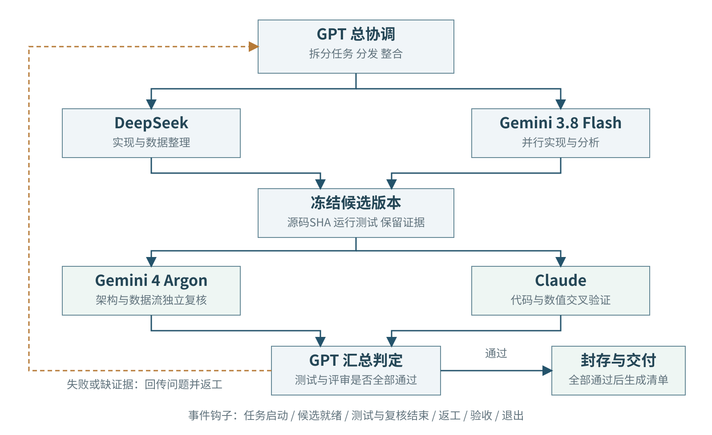

# 多智能体协同技能增补

本增补按用户指定绘制协作闭环。GPT协调DeepSeek和Gemini 3.8 Flash完成子任务；Gemini 4 Argon与Claude独立验证同一候选版本；测试、复核意见和证据返回GPT，形成有界返工闭环。

GPT先固定任务边界与验收条件，执行者隔离工作，整合后冻结候选SHA。验证者检查相同快照及原始证据，必要测试同时运行。若失败或缺证据，反馈回GPT进行下一轮；全部通过后才封存。模型给出“通过”不能替代真实测试。

钩子安排在任务启动、候选就绪、测试结束、复核结束、返工、验收和任务退出事件上。它们负责衔接流程和留存记录，轮次与预算有上限，避免无限返工。现有15分钟检查的系统定时器只覆盖竞赛项目，不能据此声称本项目已安装自动调度。

本次只更新技能说明、图、PPT与讲稿，未执行外部模型联合调用，也未部署常驻钩子服务。模型版本与API配置应在实际运行时记录。用户确认Cloud指Claude。

## 与Roofline页的衔接

搬运账本提供Q，活动记录提供T，矩阵尺寸提供N。多智能体协作组织这些任务并交叉检查：有无混用样例、带宽是否重复相加、busy是否被当成有效MAC。评审发现问题后回传GPT，下一轮修正计算或实现，再重新定位Roofline点位。

## 名称依据

Google官方模型表核实Gemini 3.8 Flash与Gemini 4 Argon及其API编号： https://ai.google.dev/gemini-api/docs/models 。Claude的具体版本本次不指定，参照官方模型列表： https://platform.claude.com/docs/en/models/overview 。
