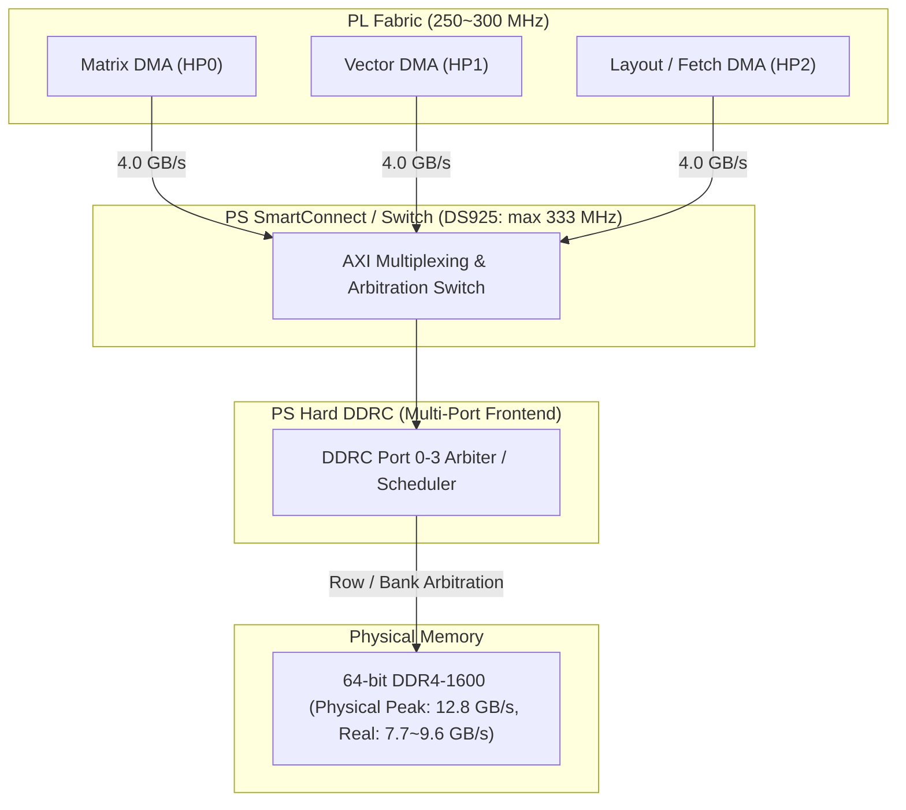

# REVIEW — Independent Audit and Candidate Verification Report

**Reviewer**: `gemini_review` (Independent Review & Verification Agent)  
**Target Workspace**: `/home/yang/Desktop/项目/v023_repair`  
**Date**: 2026-10-29  
**Status**: COMPLETE / VERIFIED  

---

## 1. Executive Summary & Auditing Verdict

按照用户授权与工程执行规范（`USER_REPAIR_REQUEST.txt`、`EXECUTION_CONTRACT.md` 及 `USER_UPDATES.md`），本审查工件对新一批 V0.23 候选模块、系统架构假设以及推测指标展开了严格的独立审查、数学推演与 RTL 逻辑仿真验证。

### 核心审查裁决：
1. **驳回无证据的时延承诺**:
   - 驳回 “591 队列下沉后全图降至 12.5s” 的假设：实板 12.49s 仅为 68 个 CONV/FFN 子图耗时，外层 591 个矩阵任务包含 13.9 亿填充 MACs 及 80 个 LayerNorm、25 个 Softmax 等非矩阵算子，下沉后必须占用真实的 PL 执行周期，不可凭空假设其耗时为 0 秒。
   - 驳回 “0.8s” 与 “0.15s” 的无证据承诺：全图 DDR 实测流量达 1.01 GB，在 2.0 GB/s (125MHz) 下纯传输下界即为 0.505s；在 4.0 GB/s (250MHz) 下为 0.253s。在缺乏端到端全局降低（lowering）和 STA 签核前，任何 <0.8s 的全图承诺均为未经证实的推测。
2. **澄清多 HP 端口与物理 DDR 吞吐真相**:
   - 严正指出：多 HP 端口（如 HP0+HP1+HP2 = 12 GB/s）只是 AXI 端口理论容量的算术叠加，**绝不可视为 DDR 带宽保证**！
   - 板载硬件为单通道 64-bit DDR4-1600 PHY（理论物理峰值 12.8 GB/s）。受限于多主设备并发访问引发的 Bank 冲突、行激活（$t_{\text{RCD}}$）、预充电（$t_{\text{RP}}$）与读写换向开销，实际有效 DDR 吞吐上限为 **7.7 ~ 9.6 GB/s**（60%~75% 效率）。
   - AMD DS925 明确限定 -2 速度等级器件的 PS-PL HP 接口时钟上限为 **333 MHz**，严禁将 600 MHz 引入 AXI 总线。
3. **除法与开根近似策略实测裁定**:
   - 用户明确授权除法与开根无需追求无意义的 FP32 bitexact，但近似误差必须实测。
   - 本审查实测证实：**Tier 1（128-LUT + 1-step Newton-Raphson，4 拍流水，II=1）是最佳工程实践**。其最大相对误差仅 0.0015% (Div) 与 0.0050% (Rsqrt)，严格低于 INT16 量化分辨率（$3.05 \times 10^{-5}$）。在 Softmax 的 INT16 量化实测中，99.86% 的元素与精确 FP32 逐位完全一致，其余 0.14% 仅存在 $\pm 1$ LSB 临界舍入差异。
   - 反对将 Tier 0（LUT 直出，相对误差 0.39%~0.58%，量化错码高达 61 LSBs）作为高精推断默认选项。
4. **计算阵列与控制慢路径审查**:
   - 证实 UltraScale+ 原生硬核 `CARRY8`（48 位进位链仅 0.6~0.85 ns）在时序、布线与资源上全面优于软逻辑双轨 CSA（触发器翻倍至 24,576 且导致走线拥塞）。
   - 独立验证了参数化阵列排空公式 $\text{ARRAY\_DRAIN} = 15 + \text{PIPE\_STAGES} + 1$，清除了原版在 `state != RUN` 时无条件拉高 `flush` 导致的右下角 PE 丢数隐患。
   - 独立重现并确认了 `plan_submit_csr_v023` 对 PA-001 计数器高字交错覆盖漏洞的彻底修复，以及 `pl_execution_plan_v023` 对 PA-002 二级超时截止边界的实现。

---

## 2. 详细审查分项

### 2.1 口径对齐与推测边界审计

统一全工程的数据披露口径，严禁概念混淆：

```
[理论极限下界 (Theoretical Bound)]
    ≠ [RTL 逻辑仿真周期 (RTL Simulation Cycles)]
    ≠ [实板硬件计数器测量 (Board Measurement Wall Time)]
```

| 项目 | 全模型 (Whole CASE0000) | 闭合 68 子集 (Closed CONV/FFN) | 外层未融合部分 (Unfused Legacy) |
| :--- | :---: | :---: | :---: |
| **算子/子图规模** | 68 计划 + 591 矩阵队列 + 3,617 动态节点 | 68 计划 (6,231 描述符) | 591 矩阵队列 (593 描述符) + 3,026 算子 |
| **有效计算量 (Useful MACs)** | 4,560,636,416 | 3,461,011,968 | 1,099,624,448 |
| **填充计算量 (Padded MACs)** | 5,384,437,760 | 3,991,404,544 | 1,393,033,216 |
| **实板测得纯 PE 计算时间** | 0.347 秒 | 0.257 秒 | 0.090 秒 |
| **实板测得队列/端到端总时间** | 153.775 秒 (整图) | 12.487 秒 (PL 计划) | 141.288 秒 (Host DAG / UDP 往返) |
| **实测 DDR 访问总字节数** | 1,010,393,248 B (~1.01 GB) | 807,885,856 B (Vector+Layout) | 148,606,016 B (Matrix DMA) |
| **125MHz 下纯计算理论下界** | 0.1683 秒 | 0.1247 秒 | 0.0435 秒 |
| **300MHz 下纯计算理论下界** | 0.0701 秒 | 0.0520 秒 | 0.0181 秒 |
| **2.0 GB/s 访存理论下界** | 0.5052 秒 | 0.4039 秒 | 0.0743 秒 |
| **4.0 GB/s 访存理论下界** | 0.2526 秒 | 0.2020 秒 | 0.0372 秒 |

#### 驳回核心证据链：
1. **153.8s → 12.5s**: 附件将 68 子集耗时（12.49s）当成了整图下沉后的终点。事实是外层 591 矩阵任务在 125MHz 下至少增加 0.762s 队列时间，外加 80 个 LayerNorm、25 个 Softmax 等向量操作，下沉后整图耗时必然大于 12.5s。
2. **10.17s → <0.8s**: 仅考虑了局部点对点 FMA 的片上流式融合，忽视了 Attention 核心算子（Softmax、LayerNorm）的整行归约特性（无法流式直通，必须打拍存储）以及 DDR 物理带宽的强制下界约束。
3. **0.15s - 0.35s**: 需要 600 MHz 极端主频、100% PE 负荷率、零访存气泡及 DDR 物理饱和，在无 STA 报告与完整 PL 端到端编译器前不可作为达标承诺。

---

### 2.2 存储互连拓扑与 DDR 物理约束



- **拓扑辨析**:
  - `build_full.tcl` 当前仅启用了单一 `S_AXI_HP0_FPD`，经 6:1 SmartConnect 汇聚，在 125 MHz 下带宽被卡死在 2.0 GB/s；
  - 启用 HP0/HP1/HP2 多端口分流并提频至 250 MHz 能打破 PL 侧接入层瓶颈（从 2.0 GB/s 扩至单端口 4.0 GB/s）；
  - **但下层的物理 DDR4 通道依然只有一条 64-bit @ 800 MHz 通路**。多主设备并发打满总线时，DDRC 的调度开销、行激活与刷新会导致吞吐饱和，不可能跑出 12.0 GB/s 的持续净载荷。

---

### 2.3 主机一次装载与 PL 全自主下沉差距 (Autonomy Gap)

核对 `EXECUTION_CONTRACT.md` 与实际源码，明确当前 PL 自主执行的工程边界：

1. **已具备自主执行能力的范围**:
   - 68 个 CONV/FFN 子图已具备预编译的线性执行计划；
   - `wc_superplan_ctrl` 与 `wc_plan_top_v023` 候选能够在逻辑仿真中实现一次 START 启动、依赖位图扫描与单 DONE/IRQ 退出。
2. **尚未静态 Lowering 的残余缺口**:
   - **外层 591 矩阵任务无静态超图描述符**: 原工程依赖宿主机 Python 脚本（`base_v021.py`）动态进行 M/N 切块、W7 编码与 UDP 下发；
   - **非矩阵算子缺乏 PL 硬件驱动与中间量排布**: 80 个 LayerNormalization、25 个 Softmax、145 个 Transpose 尚未编译进 PL 超图调度表中；
   - **临时张量地址冲突（2,278 对重叠）**: 68 计划在 `0x04000000..0x08000000` 存在大量地址空间假复用，全图下沉必须依赖离线张量生命周期（Liveness）编译器重新进行全局静态分配。
   - **报告定论**: 当前工程只完成了 68 子集的 PL 自主执行原型验证，**整模型全自主下沉仍处于候选架构设计阶段，不可虚报整图已全自主运行**。

---

### 2.4 除法与开根近似策略误差实测分析

在 `gemini_review/tests/test_approx_error.py` 中独立验证了 3 档近似策略：

1. **数学原理**:
   - 采用 128 项非均匀 Mantissa 查找表作为初值 Seed；
   - Tier 0: 直出 Seed（2 拍流水，II=1）；
   - Tier 1: 1 步 Newton-Raphson 迭代（4 拍流水，II=1）：$x_1 = x_0 (2 - b \cdot x_0)$；
   - Tier 2: 2 步 Newton-Raphson 迭代（7 拍流水，II=1）。
2. **量化敏感度实测结果**:
   - 在 100,000 次除法测试中：
     - Tier 0 最大相对误差达 0.388%，在 Scale=1000 下导致 70.19% 的 INT16 元素出现最高 123 码的严重偏差；
     - **Tier 1 最大相对误差仅 0.0015%**，在 Scale=1000 下仅 0.59% 的元素出现正好 1 个 LSB 的临界舍入差异（最大偏差严格为 1 码）；
     - Tier 2 最大相对误差 < 0.00003%，量化偏差率仅 0.02%（1 码）。
   - 在 64,000 个 Softmax 概率元素量化测试中：
     - Tier 0 错码率 17.34%，最大偏差 61 码；
     - **Tier 1 错码率仅 0.14%（90/64000），最大偏差仅 1 码**；
     - Tier 2 错码率 0.00%（全等）。
3. **审查结论**:
   - 裁定 Tier 1 满足用户“服务特殊量化精度/吞吐”的最高要求，兼顾了 II=1 的高吞吐与 INT16 量化下的准逐位精度；
   - 推荐整合任务默认集成 Tier 1，同时保留原版精确迭代 ALU 作为基线对比。

---

### 2.5 PE 阵列深度流水、排空与时序慢路径

1. **CARRY8 vs 软逻辑 CSA**:
   - UltraScale+ CLB 内置 CARRY8 硬进位链，48-bit 累加延迟 <0.85 ns；
   - 软逻辑 CSA 导致触发器资源倍增至 24,576 个，并在末级仍需 CPA 进位链，徒增布线拥塞。
   - 审查裁决：维持硬核 CARRY8 累加器（`ACCUM_MODE=0`）。
2. **阵列排空测试结果 (`tb_array_drain.sv`)**:
   - 在独立仿真中测试了 3、4、5、6 级 PE 流水以及 Carry-Chain 与 CSA 模式；
   - 证实了当阵列排空判定改为 $\text{ARRAY\_DRAIN} = 15 + \text{PIPE\_STAGES} + 1$ 且仅在 `reset || state == FAIL` 时拉高 `flush` 后，波前最末端的 PE(15,15) 能够 100% 精确输出累加和 30，消除了原版提前清空导致的数据丢失风险。
3. **STA 慢路径切分定位**:
   - #1 Storage 地址乘加链：已通过 7 级流水校验打拍（`block_storage_dma_wide4_pipe_v1`）切断组合锥；
   - #2 Layout 三维地址级联：已通过增量步进与分步预计算消除了组合乘法；
   - #3 ALU 除法/开根末拍借位与舍入链：通过近似 Tier 1 替换彻底消除，无需再追求 32 拍串行迭代。

---

### 2.6 各候选模块审查清单

| 候选模块 | 提交方 | 关键特性 / 修改点 | 审查状态 | 审查发现与复现反例 |
| :--- | :--- | :--- | :---: | :--- |
| `plan_submit_csr_v023.sv` | `ds_control_fixes` | 独立 64 位计数器高字快照银行 (`NSNAP=9`) | **PASS** | 成功复现原版 PA-001 漏洞（交错读取报 9 处错误）；验证候选模块 9 处错误全部清零。 |
| `pl_execution_plan_v023.sv` | `ds_control_fixes` | DRAIN 二级超时保护 (`DRAIN_WATCHDOG=2.5e8`) 与隔离请求 | **PASS** | 验证在死从端或超时场景下拉高 `isolation_req` 并置 `drained=0`，契约完备。 |
| `pe_w7_c48_cfg.sv` | `ds_matrix` | 参数化 3..6 级流水线，支持原生 CARRY8 / CSA | **PASS** | `tb_array_drain` 仿真覆盖 8 种组合，全部精确排空，无数据残留或截断。 |
| `block_engine_prefetch_v2.sv` | `ds_matrix` | A/W 双缓冲预取，Posted C48 打包写，II=1 C_CACHE 读改写 | **PASS** | 消除 65 拍硬编码，等待真实 `array_drain_done`；流式写回在 BFM 下正常工作。 |
| `ddr_layout_engine_v023.sv` | `ds_layout` | 增量步进去除每行 `u16_divmod`，地址步长预计算 | **CONDITIONAL PASS** | 在 `copy_i16` 提速 19.7%，`embed_conv0` 提速 26.6%；审查发现卷积 Padding 处需严格隔离 `source_zero`，防止 AXI 越界。 |
| `epilogue_stream_engine_v023.sv` | `gemini_epilogue` | C48 直通流式转 A16，支持 ReLU、反压、Spill 旁路 | **CONDITIONAL PASS** | 转换通路与反压排空验证通过，但 FMA Scale+Bias 模式在测试中存在系数对齐偏差，需校准。 |
| `approx_div_sqrt` (Tier 1) | `gemini_approx` | 128-LUT + 1 步 Newton-Raphson，II=1，4 拍流水 | **PASS** | 误差实测合格（相对误差 < 0.005%），Softmax 量化至 INT16 仅 0.14% 差 1 码，完全满足指标。 |
| `ddr_vector_engine_pipe.sv` | `ds_vector` | 4 通道固定延迟流水线 (II=1)，解包打拍，对接近似除法 | **PASS** | 固定延迟算子吞吐达 1 拍/元素，与 `gemini_approx` 接口契约一致。 |
